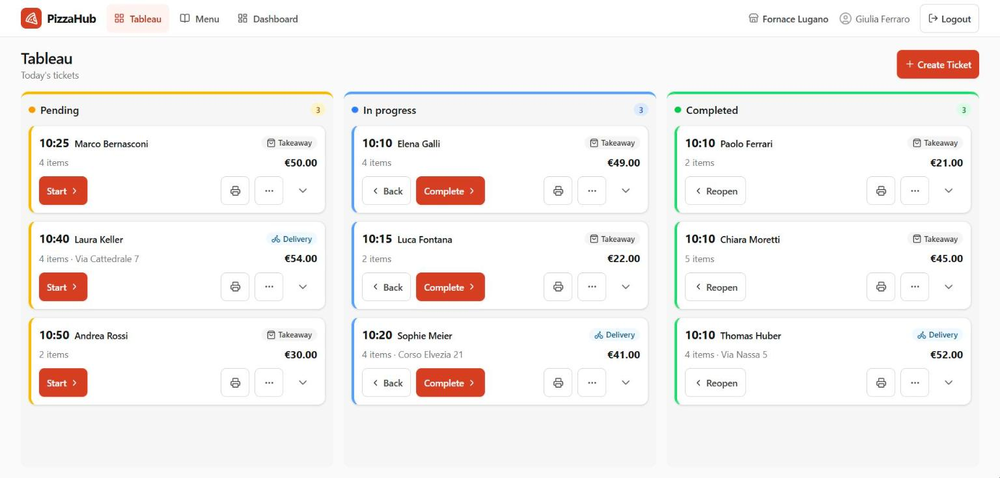
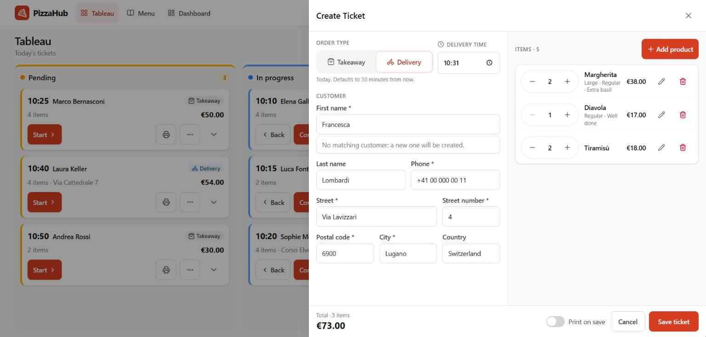
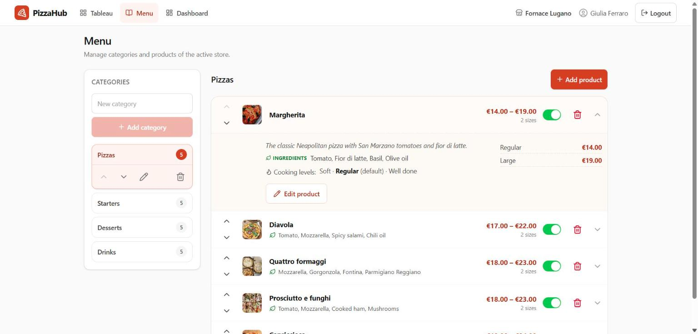
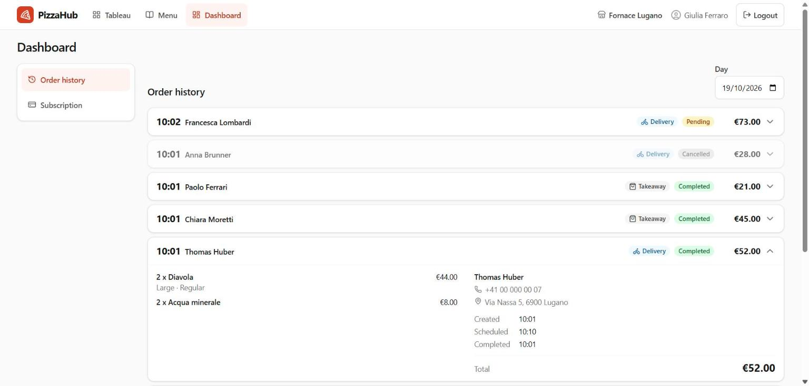
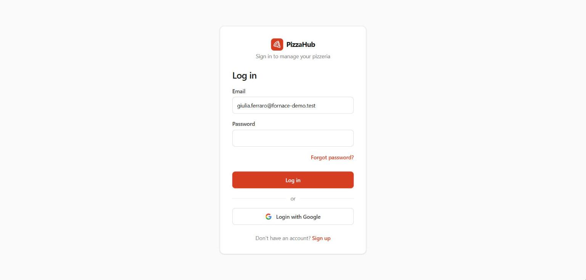
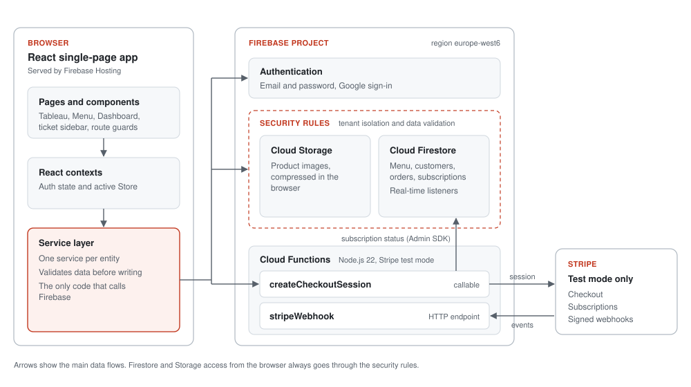

# PizzaHub

**Real-time takeaway and delivery order management for pizzerias.**

PizzaHub is a web application for pizzeria staff. They set up their pizzeria, manage the menu, enter takeaway and delivery orders, and track the day's tickets on a live board shared across all open devices. It is a React single-page app built on Firebase, with Stripe subscriptions in test mode.

**[Live demo](https://pizzahub-11284.web.app)**

> This repository is a project showcase. It contains documentation and screenshots only; the application source code is not included.

## The problem

On a busy evening, a small pizzeria takes orders by phone and at the counter, often on paper slips. Delivery addresses get misread, the kitchen and the counter lose track of what is ready, and once the evening is over there is no reliable record of what was sold.

PizzaHub replaces the slips with structured tickets and a shared board:

- Every order is entered once, with its items, customer and scheduled time.
- Delivery orders cannot be saved without a complete address and phone number.
- The **Tableau** shows the day's tickets in three columns. When a ticket moves from *Pending* to *In progress* to *Completed*, the change appears immediately on every open screen.
- The **Dashboard** keeps a day-by-day order history.

## Screenshots

All screenshots show fictional demo data.

| Creating a delivery ticket | Menu management |
|---|---|
|  |  |

| Order history | Sign-in |
|---|---|
|  |  |

## Features

**Orders and the Tableau**
- Takeaway and delivery tickets with a scheduled time, item sizes, cooking levels, free-text customizations and quantities. The total is calculated automatically.
- A live board with *Pending*, *In progress* and *Completed* columns, kept in sync across devices. On phones it shows one column at a time.
- Tickets can move forward and back between statuses (Start, Complete, Back, Reopen). They can be edited in any status. Cancelled tickets are kept as records rather than deleted.
- When an item is edited, what can still change depends on whether the product is still available, marked unavailable or removed from the menu.

**Customers**
- Customers are created and looked up from the ticket form. A customer's details are reused across orders, and edits appear on every ticket card for that customer.

**Menu**
- Categories and products can be created, edited, deleted and reordered.
- Each product can have either a single price or a price per size, plus ingredients, cooking levels and an availability switch.
- Product images are resized and compressed in the browser before upload.
- Tickets can only be taken once the menu has at least one valid product.

**History and receipts**
- The order history for any past day also lists cancelled orders, and each order expands into a read-only detail view.
- A receipt print preview is formatted for 58 mm thermal printers.

**Account and subscription**
- Sign-in with email and password or with Google, plus password reset.
- An onboarding step creates the company, its store and the administrator account together.
- A monthly subscription through Stripe Checkout in **test mode**. Its status updates live from Stripe webhooks, and a non-blocking banner reminds the user while the subscription is inactive.

**Current limitations**
- Each company has one store and one administrator account. There are no staff roles yet.
- Receipts are print previews only; the app does not connect to a printer.
- Payments work in Stripe test mode only.
- Customers are managed from tickets; there is no separate customer directory.

## Tech stack

| Area | Technologies |
|---|---|
| Frontend | React 19, React Router 8, Vite 8, Tailwind CSS 4, Lucide icons, JavaScript (no TypeScript) |
| Backend | Cloud Functions for Firebase (2nd gen) on Node.js 22 |
| Data and auth | Cloud Firestore, Firebase Authentication, Cloud Storage, security rules |
| Payments | Stripe Checkout, subscriptions and webhooks (test mode) |
| Quality | Vitest, Testing Library, Firebase Emulator Suite, Oxlint, JSDoc |
| Delivery | Firebase Hosting, GitHub Actions |

## Architecture

- **No custom backend server.** The browser talks to Firebase directly, and the security rules decide what each user may read and write. The only server-side code is two Cloud Functions for Stripe: one creates a Checkout session, and the other receives webhook events.
- **The service layer is the only access point to Firebase.** Components never call Firebase directly. Each entity has its own service, which validates data before writing, so the UI stays independent of the database and easy to test.
- **Route guards are chained.** Pages are gated in order: a signed-in user, then a company profile, then an active store. Until the menu has at least one valid product, only the Menu page is reachable.
- **Data is live where it matters.** The Tableau and the ticket cards use Firestore real-time listeners. The order history is read once per selected day instead.
- **Orders keep item snapshots.** Each order stores its own copy of the product name, size, price and options, so later menu changes never rewrite past tickets.

## Engineering decisions and security

These are design decisions implemented in the code. They have not undergone an external security audit.

- **Tenant isolation:** every read and write is limited to the user's own company and store. The security rules derive this from the user's profile, never from data the client sends.
- **Onboarding in one transaction:** the company, store and administrator account are created in a single transaction. They cannot be reassigned afterward.
- **Validation at three layers:** the same field limits are applied in the forms, in the services and in the security rules. The rules also check field types, required fields and immutable fields.
- **Order lifecycle in the rules:** only valid status changes and content edits are accepted. A cancelled order is final, and orders are never deleted.
- **Server-owned billing state:** only the Cloud Functions can write a subscription's status. The paying company is derived from the authenticated user, not from the request.
- **Webhook handling:** Stripe signatures are verified, and stale events that arrive out of order are ignored. Creating the Stripe customer is idempotent, and a company cannot open a second subscription while one is active.
- **Test-mode guard:** the functions refuse any Stripe key that is not a test key.

## Testing and quality

Tests use Vitest and Testing Library; the Firestore, Storage and end-to-end tests run against the Firebase Emulator Suite.

**842 automated tests, all passing** at v1.0.2 (last run on 28 October 2026):

| Suite | Files | Tests |
|---|---|---|
| Client: services, utilities, components and pages | 52 | 809 |
| ↳ of which Firestore and Storage security rules | 2 | 124 |
| ↳ of which end-to-end flow | 1 | 10 |
| Cloud Functions: Checkout and webhook handlers | 3 | 33 |

- **Security-rules tests** (113 for Firestore, 11 for Storage) run against the emulators and check tenant isolation, field validation and the allowed order transitions.
- **The end-to-end test** covers registration, onboarding, menu setup, takeaway and delivery orders, status changes and the order history.
- **The Cloud Functions tests** run against in-memory fakes of Firestore and Stripe, with no network access.
- **Continuous integration:** every pull request to `develop` or `main` triggers workflow linting, Oxlint, the client suite on the emulators and a production build. The Cloud Functions suite runs locally, not in CI.
- Test coverage is not measured.

## Development process

- Work followed a milestone roadmap and a written product specification.
- Each milestone had its own branch, merged into `develop` and then into `main` through pull requests checked by CI.
- Releases are tagged with semantic versions, from v0.1.0 to the current v1.0.2.
- Functions, components and helpers are documented with JSDoc.

## Demo and project status

PizzaHub is an MVP (**v1.0.2**) available as a live demo at [pizzahub-11284.web.app](https://pizzahub-11284.web.app).

- Using the demo requires creating an account; no shared demo credentials are provided.
- Payments run in Stripe test mode only, so no real charge can be made.
- The interface is in English and shows prices in euros.

The app has been trialed in a pizzeria and with non-technical users to gather usability feedback. It is not in commercial use.

## Possible next steps

The following ideas are **not implemented**:

- Staff accounts with separate roles.
- Multiple stores per company.
- Email verification and account deletion.
- Subscription management (cancellation, payment method) from inside the app.

## Author

Built by **Samuele Deriu** · [GitHub](https://github.com/SamExperience)
